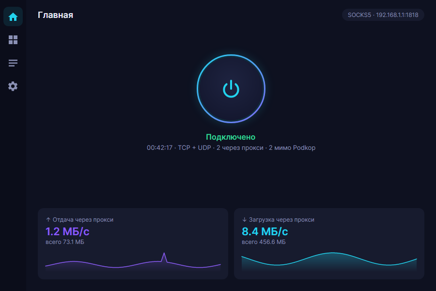
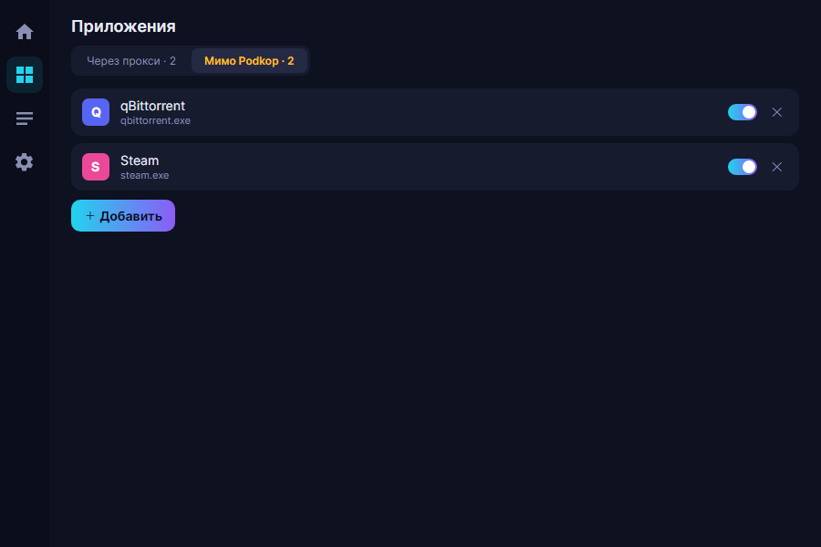
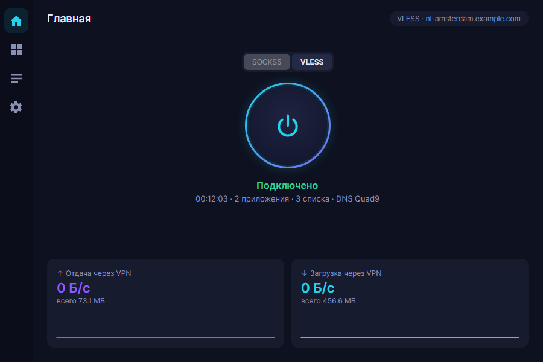
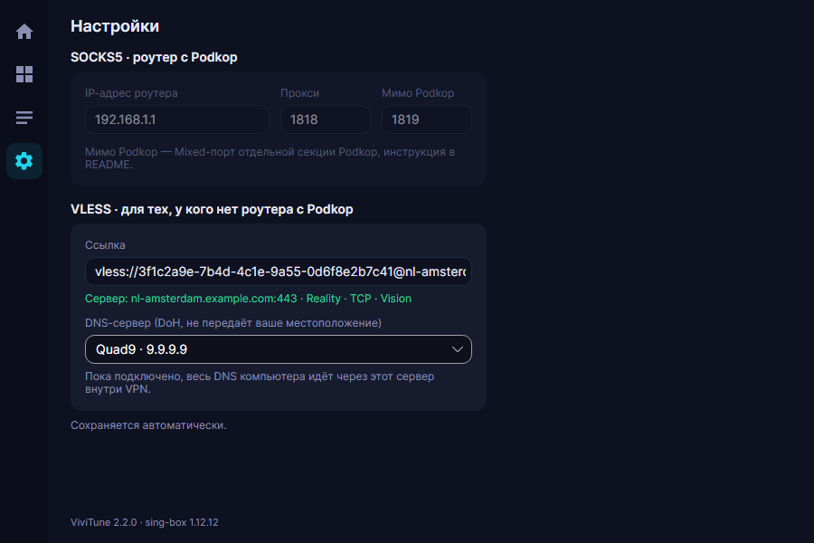
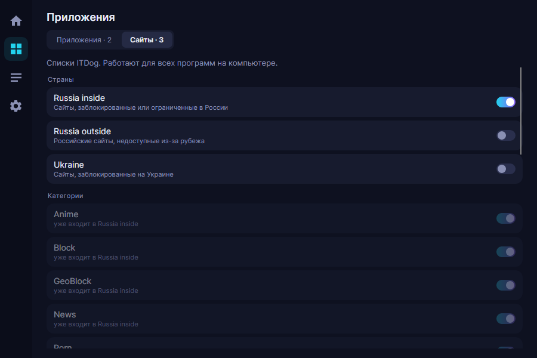

# ViviTune

Пускает трафик **только выбранных программ** Windows через SOCKS5-прокси. Например, через роутер с [Podkop](https://github.com/itdoginfo/podkop). Остальной трафик идёт напрямую, как обычно. Есть и второй список, «Мимо Podkop»: его программы идут в отдельный порт роутера, и пока этот порт отвечает, они выходят мимо VPN Podkop; если не отвечает, ViviTune предупреждает (см. [ниже](#мимо-podkop)).

Типичный сценарий: Discord (голос и стримы) и пара игр ходят через роутер, а браузер, Steam и всё прочее — напрямую.




## Как это работает

ViviTune запускает [sing-box](https://github.com/SagerNet/sing-box) в режиме TUN. Соединения выбранных программ (по имени `.exe`) и их DNS-запросы уходят в SOCKS5-прокси (у программ «Через прокси» DNS идёт через `1.1.1.1` по прокси, а программы «Мимо Podkop» разрешают имена как обычно, через роутер), всё остальное идёт напрямую. При отключении или закрытии ViviTune sing-box останавливается и маршруты убираются.

## Требования

- Windows 10/11 x64.
- Права администратора: без них нельзя создать TUN-интерфейс, Windows спросит при запуске.
- SOCKS5-прокси без пароля. Если у вас роутер с Podkop, такой прокси включается одной галочкой, см. [ниже](#включение-mixed-прокси-в-podkop).

## Установка

1. Скачайте `ViviTune-2.1.0-win-x64.zip` со страницы [Releases](../../releases/latest).
2. Распакуйте в отдельную папку, куда есть права на запись (например, `C:\Tools\ViviTune`, но не `Program Files`): настройки хранятся в `settings.json` рядом с программой.
3. `sing-box.exe` должен лежать рядом с `ViviTune.exe`.
4. Запустите `ViviTune.exe` и подтвердите запрос прав администратора.
   Если появится окно «Windows защитил ваш компьютер», нажмите «Подробнее» → «Выполнить в любом случае»: программа не подписана сертификатом.

## Использование

1. **Настройки**, блок «Прокси SOCKS5»: укажите «IP-адрес роутера» (LAN-адрес роутера с Podkop, например `192.168.1.1`) и «Прокси» — порт Mixed-прокси. Поле «Мимо Podkop» — порт второго Mixed-прокси, нужно только если пользуетесь списком «Мимо Podkop» (см. [ниже](#мимо-podkop)). Изменения сохраняются сами. Настройки (все поля) можно менять только в отключённом состоянии.
2. **Приложения:** две вкладки, «Через прокси» и «Мимо Podkop» (число рядом с названием — сколько в ней включённых программ). Программа может быть только в одном списке: если добавить её в другой, она переедет туда. Панель добавления не показывает программы, которые уже есть в любом из списков, поэтому чтобы перенести программу, выберите её через «Выбрать .exe вручную…» на другой вкладке или удалите и добавьте заново. На нужной вкладке нажмите «＋ Добавить» и выберите программу из запущенных. Программы без окна собраны в свёрнутом разделе «Фоновые». Можно указать файл через «Выбрать .exe вручную…». Переключатель справа временно выключает приложение без удаления, крестик удаляет его из списка.
3. **Главная:** нажмите кнопку питания. ViviTune проверит прокси и, если он задан, порт «Мимо Podkop»; подключиться можно и когда один из них не отвечает (с предупреждением). Внизу видна скорость и объём трафика, который идёт через прокси.
   - `TCP + UDP`: всё работает, включая голос и игры.
   - `только TCP`: прокси не пропускает UDP, поэтому голосовая связь и игры могут не работать.
   - Строка вида `00:42:17 · TCP + UDP · 2 через прокси · 2 мимо Podkop` показывает, сколько программ идёт через каждый список.
   - Предупреждения ViviTune показывает жёлтым цветом под статусом.
4. **Перезапустите выбранные программы** после подключения: соединения, открытые до него, остаются прямыми.
5. Список приложений можно менять и при включённом прокси: ViviTune сам перезапустит sing-box.
6. Крестик окна сворачивает ViviTune в трей. В меню трея есть «Открыть», «Подключить»/«Отключить» и «Выход».
7. **Лог:** события и ошибки sing-box, пригодится, если что-то не работает.

## Включение Mixed-прокси в Podkop

[Podkop](https://github.com/itdoginfo/podkop) — проект [ITDog](https://github.com/itdoginfo) для точечной маршрутизации трафика на OpenWrt. Документация: [podkop.net](https://podkop.net/). Спасибо авторам за отличный инструмент! Если он вам пригодился, поставьте им звезду на GitHub.

Mixed-прокси — встроенная функция Podkop: роутер открывает порт, который принимает SOCKS5 и HTTP и отправляет **весь** трафик с этого порта через прокси или VPN выбранной секции, независимо от списков доменов. Именно это и нужно ViviTune. UDP через SOCKS5 тоже работает.

### Через веб-интерфейс (LuCI)

1. Откройте веб-интерфейс роутера (обычно http://192.168.1.1) → **Службы → Podkop**.
2. Перейдите на вкладку **Секции** (Sections) и выберите секцию, через которую должен идти трафик (по умолчанию `main`). У неё **Тип подключения** (Connection Type) должен быть `Proxy` или `VPN`: для других типов опции нет.
3. Отметьте **Включить смешанный прокси** (Enable Mixed Proxy).
4. В поле **Порт смешанного прокси** (Mixed Proxy Port) укажите свободный порт, например `1818`.
5. Нажмите **Сохранить и применить**.

### Через SSH

```sh
uci set podkop.main.mixed_proxy_enabled='1'
uci set podkop.main.mixed_proxy_port='1818'
uci commit podkop
/etc/init.d/podkop restart
```

Здесь `main` — имя секции. Если ваша секция называется иначе, подставьте её имя (список: `uci show podkop | grep =section`).

### Что учесть

- Прокси слушает LAN-адрес роутера (тот, что у интерфейса `lan`), поэтому в ViviTune указывайте его, например `192.168.1.1:1818`.
- Пароля у Mixed-прокси нет: им может пользоваться любое устройство в вашей локальной сети.
- В стандартной настройке OpenWrt входящие соединения из LAN разрешены. Если вы меняли правила firewall для зоны `lan`, откройте этот порт.
- Инструкция проверена по исходникам Podkop 0.7.24. В старых версиях этой опции может не быть: обновите Podkop.

## Мимо Podkop

Зачем. Podkop может завернуть в VPN программу, чей домен или IP есть в его списках: торренты, банки, игры с античитом. Список «Мимо Podkop» это исключает. Его программы идут в отдельный Mixed-прокси на роутере, который выпускает трафик в обход Podkop, через физический WAN-интерфейс.

### Как настроить секцию в Podkop

Способ описан в FAQ ITDog: [Как отправить торренты в обход Podkop](https://podkop.net/docs/faq/#kak-otpravit-torrenty-v-obhod-podkop). Коротко:

1. В Podkop (**Службы → Podkop → Секции**) создайте новую секцию с типом подключения **VPN**.
2. В поле сетевого интерфейса выберите **custom** и впишите имя физического WAN-интерфейса. Узнать его можно на роутере командой `route -n`, это столбец **Iface** у маршрута по умолчанию. Надпись «Absent Interface» рядом можно игнорировать.
3. Отметьте **Включить смешанный прокси** и укажите свободный порт. Занятые порты видны по команде `netstat -tanp | grep LISTEN`.
4. Нажмите **Сохранить и применить**.

### В ViviTune

1. «Настройки» → поле «Мимо Podkop»: введите порт из предыдущего шага.
2. «Приложения» → вкладка «Мимо Podkop»: добавьте нужные программы.

### Если порт не отвечает

Если порт «Мимо Podkop» не отвечает при подключении или перезапуске, программы этого списка идут обычным путём, то есть через роутер и Podkop, а ViviTune показывает предупреждение. То же самое, если порт не указан, а в списке есть программы. Если ни у одного списка с программами нет работающего порта, ViviTune покажет ошибку и не подключится.

## Режим VLESS

Для тех, у кого нет роутера с Podkop. ViviTune сам подключается к вашему VLESS-серверу, роутер не нужен. Переключатель **SOCKS5 / VLESS** находится на главной странице; менять его можно в отключённом состоянии.



### Куда вставить ссылку

«Настройки» → блок «VLESS»: вставьте ссылку `vless://…` в поле «Ссылка». Строка под полем показывает, как ViviTune её понял: сервер и порт, тип защиты (например, Reality), транспорт и flow. Если ссылка не разбирается, там будет сказано, что не так. Изменения сохраняются сами.



### Приложения и Сайты

На странице «Приложения» две вкладки:

- **Приложения**: программы, трафик которых идёт через VPN, как и в режиме SOCKS5;
- **Сайты**: готовые списки ITDog. Они работают для всех программ на компьютере, а не только для выбранных: включённый список отправляет в VPN свои домены из любого браузера и любой программы.



Некоторые списки входят в другие (например, Anime, Block и News уже входят в Russia inside): такие строки в интерфейсе отмечены «уже входит в …», отдельно включать их не нужно.

### Списки ITDog

Списки доменов и подсетей ведёт команда ITDog в проекте [allow-domains](https://github.com/itdoginfo/allow-domains). Это тот же источник, на который опирается Podkop. Огромное спасибо авторам за эту работу и за то, что она открыта для всех. ViviTune скачивает списки при подключении и хранит копию на диске: если свежую скачать не удалось, он работает со старой копией и пишет об этом в лог.

### DNS

Пока ViviTune подключён в режиме VLESS, весь DNS компьютера идёт через выбранный DoH-сервер внутри VPN. Запросы не уходят к DNS провайдера, и провайдер не видит, какие имена вы разрешаете. Сервер выбирается в «Настройках», по умолчанию Quad9.

В списке намеренно нет Google и Cloudflare: их узлы в России перехватываются средствами НСДИ, и такой DoH не даёт ожидаемой защиты.

Если при подключении ViviTune пишет «DoH-сервер … не отвечает», выберите в «Настройках» другой сервер из списка и подключитесь снова.

## Сборка из исходников

Нужен .NET SDK 10.

1. Скачайте [sing-box 1.12.12](https://github.com/SagerNet/sing-box/releases/tag/v1.12.12) для `windows-amd64` и положите `sing-box.exe` в `src/ViviTune/third_party/`.
2. Тесты: `dotnet run --project src/ViviTune.Tests`.
3. Сборка: `dotnet publish src/ViviTune -c Release -o artifacts/publish`. Получится один `ViviTune.exe`, рядом с ним `sing-box.exe` и файлы лицензий.

## Лицензия

ViviTune распространяется под [GNU GPL v3](LICENSE).

В релиз входит неизменённый `sing-box.exe` 1.12.12 (GPL-3.0-or-later, Copyright © 2022 nekohasekai). Его исходный код: https://github.com/SagerNet/sing-box/tree/v1.12.12. ViviTune — отдельный проект, он не связан ни с sing-box, ни с Podkop и не одобрен их авторами.

Лицензии остальных компонентов (.NET, Avalonia, SkiaSharp, шрифт Inter и др.) перечислены в [THIRD-PARTY-NOTICES.txt](THIRD-PARTY-NOTICES.txt).
